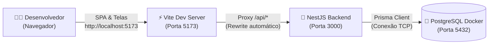
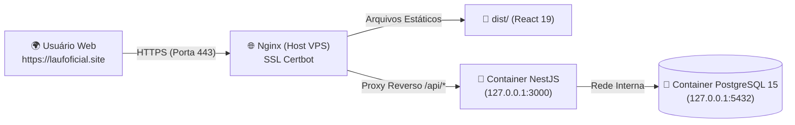

# Portal LAUF — Liga de Arduino Uninassau Fortaleza

[](https://nodejs.org/)
[](https://pnpm.io/)
[](https://react.dev/)
[](https://nestjs.com/)
[](https://www.prisma.io/)
[](https://www.postgresql.org/)
[](https://www.docker.com/)

Bem-vindo ao repositório oficial do **Portal LAUF**! Este sistema é uma plataforma completa e moderna para apoiar a gestão acadêmica da **Liga de Arduino Uninassau Fortaleza (LAUF)**, centralizando:
- 👥 **Gestão de Membros e Diretoria**: Controle de acesso por cargos (`ALUNO`, `PROFESSOR`, `MONITOR`, `COORDENADOR`).
- 📚 **Catálogo de Aulas & Eventos**: Agendamento, histórico e visualização de aulas ministradas.
- 📱 **Controle de Presença em Tempo Real**: Validação de presença ágil via QR Code dinâmico e código numérico.
- 🎓 **Emissão e Solicitação de Certificados**: Desacoplamento de solicitações e emissão auditável de certificados.

O projeto é estruturado como um **Monorepo** moderno utilizando **pnpm workspaces**, unificando frontend, backend e contratos de domínio em uma única base de código tipada de ponta a ponta.

---

## 🏗 Arquitetura do Monorepo

O monorepo é dividido em workspaces isolados com responsabilidades bem definidas:

```text
📁 lauf-site-oficial (root)
├── 📁 apps
│   ├── 📁 frontend         # Single Page Application (React 19 + Vite + TailwindCSS v4)
│   └── 📁 backend          # API RESTful (NestJS 11 + Prisma ORM 7 + PostgreSQL 15)
├── 📁 packages
│   └── 📁 shared           # Pacote @lauf/shared (Enums, Nano IDs semânticos e DTOs)
├── 📁 context
│   └── 📁 adrs             # Architecture Decision Records (Registros de Decisões)
├── 📁 .github
│   ├── 📁 ISSUE_TEMPLATE   # Formulários YAML estruturados para Issues
│   ├── 📄 pull_request_template.md # Template padronizado de Pull Request
│   └── 📁 workflows        # Pipelines de Integração Contínua (CI)
├── 📄 docker-compose.yml   # Banco de Dados PostgreSQL para Desenvolvimento Local
├── 📄 pnpm-workspace.yaml  # Declaração dos Workspaces pnpm
└── 📄 package.json         # Scripts globais do monorepo
```

### Topologia de Rede em Desenvolvimento (Local)

Em ambiente local, o servidor Vite atua como proxy reverso para a API NestJS, eliminando problemas de CORS e garantindo que cookies de sessão `HttpOnly` trafeguem perfeitamente no mesmo domínio `localhost`:



### Topologia de Produção (VPS / Oracle Cloud)

Em produção, os arquivos estáticos compilados do React são servidos pelo **Nginx** de alta performance com HTTPS (SSL Let's Encrypt), que faz o proxy reverso de chamadas `/api/` para o container Docker do NestJS:



---

## 🚀 Quickstart Guiado em 3 Passos

Siga o passo a passo abaixo para clonar, configurar e rodar o projeto localmente do zero.

### Pré-requisitos Essenciais
- **Node.js**: Versão `>= 24` (Node 24 LTS recomendada; [Download Node.js](https://nodejs.org/)).
- **pnpm**: Gerenciador de pacotes oficial pinado em `pnpm@11.19.0` (definido no `package.json` e ativado automaticamente via Corepack pelo script de bootstrap).
- **Docker & Docker Compose**: Pré-requisito para execução do banco de dados PostgreSQL local ([Download Docker](https://www.docker.com/)). *Nota: o bootstrap apenas verifica e diagnostica o Docker/Compose; a instalação do Docker deve ser realizada manualmente pelo usuário fora dos scripts.*
- **Sistemas Suportados pelo Bootstrap**: Debian/Ubuntu com `apt-get` e Windows com `winget`. Ambientes sem esses gerenciadores recebem orientação clara e encerramento, devendo instalar o Node.js >= 24 manualmente.

---

### Passo 1: Clonar o Repositório e Executar o Bootstrap

Abra o terminal e execute:

```bash
git clone https://github.com/Jeancaetano12/lauf-site-oficial.git
cd lauf-site-oficial
```

Execute o script de bootstrap multiplataforma de desenvolvimento antes de qualquer comando manual:

#### No Linux (Debian / Ubuntu com Bash):
```bash
bash scripts/bootstrap-dev.sh
```

#### No Windows (PowerShell):
```powershell
powershell -ExecutionPolicy Bypass -File scripts/bootstrap-dev.ps1
```

O bootstrap verifica/provisiona o Node.js >= 24, ativa o Corepack com o pin oficial `pnpm@11.19.0`, diagnostica a presença do Docker/Compose e executa `pnpm install` para instalar e linkar todos os workspaces (`apps/frontend`, `apps/backend` e `packages/shared`).

---

### Passo 2: Configurar Variáveis de Ambiente (`.env`)

Copie os arquivos de exemplo para criar suas variáveis locais:

#### No Linux / macOS (Bash / Zsh):
```bash
cp apps/backend/.env.example apps/backend/.env
cp apps/frontend/.env.example apps/frontend/.env
```

#### No Windows (PowerShell):
```powershell
Copy-Item apps/backend/.env.example apps/backend/.env
Copy-Item apps/frontend/.env.example apps/frontend/.env
```

> [!NOTE]
> - O `apps/backend/.env.example` já vem pré-configurado com a senha padrão do Docker (`adminpassword`).
> - No `apps/frontend/.env`, mantenha a linha `VITE_BACK_API_URL` comentada. Em desenvolvimento, o proxy do Vite já repassa automaticamente qualquer rota `/api` para `http://localhost:3000`.

---

### Passo 3: Inicializar o Banco de Dados & Iniciar a Aplicação

```bash
# 1. Suba o banco PostgreSQL no Docker:
docker compose up -d

# 2. Execute as migrations do banco:
pnpm db:migrate

# 3. Popule o banco com as contas e dados iniciais de teste (seed aditivo):
pnpm db:seed

# Caso esteja atualizando uma instalação anterior com matrículas legadas, use o reset forçado:
# pnpm db:seed --force

# 4. Inicie o Frontend e o Backend em paralelo:
pnpm dev
```

🎉 **Pronto! A aplicação está disponível:**
- 💻 **Frontend**: [http://localhost:5173](http://localhost:5173)
- 🔌 **API Backend**: [http://localhost:3000](http://localhost:3000)

---

## 🔑 Credenciais Padrão de Desenvolvimento (Seed)

O comando deliberado `pnpm db:seed` popula as contas de teste preservando alterações já existentes. Para restaurar as credenciais oficiais originais em bancos preexistentes, execute `pnpm db:seed --force`.

| Cargo / Perfil | E-mail | Matrícula | Senha | Permissões no Sistema |
|---|---|---|---|---|
| **Coordenador (Admin)** | `admin@lauf.com` | `240581739` | `senha123` | Acesso total: gestão de membros, aprovação de inscrições, criação de aulas e certificados |
| **Professor** | `professor@lauf.com` | `240694182` | `senha123` | Gestão de aulas ministradas, chamada de presença e validação de QR Code |
| **Aluno** | `aluno@lauf.com` | `25047381` | `senha123` | Inscrição em aulas, registro de presença em tempo real e visualização de certificados |

> [!TIP]
> **Testes Diretos de API (Postman / curl / Thunder Client):**
> Você pode autenticar qualquer requisição HTTP nas rotas protegidas do backend enviando o cabeçalho:
> ```http
> x-developer-bypass-token: 9GredaS26u1PbbTMTm50evU52a5QWErz
> ```
> O guard de autenticação concederá permissões de `COORDENADOR` automaticamente sem exigir login prévio.

---

## 🛠 Tabela de Scripts de Desenvolvimento

Comandos disponíveis a partir da raiz do monorepo:

| Comando | Descrição |
|---|---|
| `pnpm dev` | Compila `@lauf/shared` e sobe Frontend (`5173`) e Backend (`3000`) em paralelo |
| `pnpm build` | Compila todo o monorepo em cadeia (`shared` -> `backend` -> `frontend`) |
| `pnpm test` | Executa a suíte de testes unitários do monorepo (`@lauf/shared` e `backend`) |
| `pnpm lint` | Executa a verificação estática de código (ESLint) no backend e frontend |
| `pnpm typecheck` | Valida a integridade de tipagem TypeScript estrita nos 3 workspaces |
| `pnpm db:seed` | Popula ou reseta de forma controlada os dados de teste no banco |
| `pnpm db:migrate` | Aplica migrações pendentes do Prisma em desenvolvimento |
| `pnpm db:studio` | Abre a interface visual do Prisma Studio (porta 5555) |
| `pnpm --filter frontend dev` | Inicia apenas o servidor de desenvolvimento do Frontend (Vite) |
| `pnpm --filter backend start:dev` | Inicia apenas a API NestJS com recarregamento a quente (*watch mode*) |

---

## 🩺 Guia Prático de Troubleshooting

Soluções para os problemas mais frequentes encontrados em ambiente de desenvolvimento:

### 1. Erro: `Port 5432 is already allocated` ou `address already in use`
- **Causa**: Você já possui uma instância nativa do PostgreSQL rodando no seu sistema operacional ocupando a porta `5432`.
- **Como Resolver**:
  - **No Linux (Ubuntu/Debian)**:
    ```bash
    sudo systemctl stop postgresql
    docker compose up -d
    ```
  - **No Windows (PowerShell como Administrador)**:
    ```powershell
    Stop-Service postgresql*
    docker compose up -d
    ```

### 2. Erro: `Can't reach database server at localhost:5432` (`ECONNREFUSED`)
- **Causa**: O container do Docker não está rodando ou o Docker Desktop está fechado.
- **Como Resolver**:
  - Verifique o status com `docker compose ps`.
  - Se o container estiver parado, inicie-o com `docker compose up -d`.
  - Inspecione os logs do PostgreSQL com `docker compose logs -f postgres`.

### 3. Erro de sincronia ou tipos do Prisma (`PrismaClientKnownRequestError` / tipos defasados)
- **Causa**: As definições TypeScript do cliente Prisma estão em descompasso com o banco local.
- **Como Resolver**:
  ```bash
  pnpm --filter backend exec prisma generate
  pnpm --filter backend exec prisma migrate dev
  ```

### 4. Conflito de Portas no Frontend e Cookies de Sessão
- **Causa**: Se a porta `5173` estiver ocupada por outro processo, o Vite pode subir na `5174`. No entanto, o backend valida a origem `FRONTEND_URL=http://localhost:5173` para permissão de cookies `HttpOnly`.
- **Como Resolver**: Encerre o processo na porta `5173` ou atualize temporariamente `FRONTEND_URL` em `apps/backend/.env` para a porta em que o Vite subiu. Sempre acesse a aplicação através da URL do frontend (`localhost:5173`), nunca diretamente pela porta do backend.

### 5. Erros de dependências ou cache corrompido no pnpm
- **Como Resolver**: Execute uma limpeza de cache e reinstalação forçada:
  ```bash
  pnpm store prune
  pnpm install --force
  ```

---

## 💻 Extensões Recomendadas (VS Code)

Para uma experiência ideal de desenvolvimento, recomendamos instalar as seguintes extensões no VS Code:
- **[Prisma](https://marketplace.visualstudio.com/items?itemName=Prisma.prisma)** (`Prisma.prisma`): Realce de sintaxe e autocompletar no `schema.prisma`.
- **[Tailwind CSS IntelliSense](https://marketplace.visualstudio.com/items?itemName=bradlc.vscode-tailwindcss)** (`bradlc.vscode-tailwindcss`): Autocomplete e linting de classes utilitárias no frontend.
- **[ESLint](https://marketplace.visualstudio.com/items?itemName=dbaeumer.vscode-eslint)** (`dbaeumer.vscode-eslint`): Validação estática de boas práticas em tempo real.
- **[Prettier - Code formatter](https://marketplace.visualstudio.com/items?itemName=esbenp.prettier-vscode)** (`esbenp.prettier-vscode`): Formatação automática de código ao salvar.

---

## 🤝 Governança, Contribuição e Comunidade

Quer contribuir com novas funcionalidades, melhorias de design ou correções no Portal LAUF? Sua contribuição é muito bem-vinda!

- 📖 **Diretrizes de Contribuição**: Leia o [`CONTRIBUTING.md`](./CONTRIBUTING.md) para conhecer o fluxo de branches (`tipo/issue-id-descricao`), Conventional Commits em português e a taxonomia de labels.
- 📜 **Código de Conduta**: Seguimos o padrão inclusivo do Contributor Covenant v2.1 documentado em [`CODE_OF_CONDUCT.md`](./CODE_OF_CONDUCT.md).
- 💬 **Dúvidas & Comunidade**: Acesse o canal de desenvolvimento no Discord oficial da LAUF ou abra uma issue utilizando nossos [Formulários Estruturados no GitHub](https://github.com/Jeancaetano12/lauf-site-oficial/issues/new/choose).

---

<div align="center">
  <p>Desenvolvido com carinho pela Diretoria e Membros da <b>LAUF — Liga de Arduino Uninassau Fortaleza</b>.</p>
</div>
